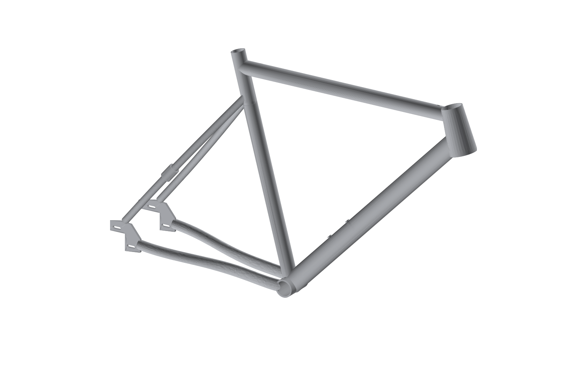

# Titanium track commuter, size 53 (S)

A belt-drive track/commuter frame with the **fit and handling geometry of the
[Schindelhauer Hektor](https://schindelhauerbikes.com/en/bikes/hektor), size 53**, re-engineered in
titanium. These files are a complete brief for a frame builder: they show what to build, and the
builder still does their own production engineering.



## What to send the manufacturer

| File | Format | What it is |
|---|---|---|
| `cad/ti_track_commuter_53_frame.step` | STEP AP214 | 3D frame solid, mm. **Main file.** |
| `cad/ti_track_commuter_53_assembly_reference.step` | STEP | Frame + reference fork, 35 mm-tyre wheels, belt sprockets, sliders, rotor, caliper envelope |
| `cad/ti_track_commuter_53_frame.stl` | STL | Mesh, for quick viewing or 3D printing a model |
| `drawings/*_sheet1_side_elevation.{dxf,pdf,svg}` | DXF 1:1 / PDF A3 1:5 | Side elevation: all geometry dimensions |
| `drawings/*_sheet2_rear_end.{dxf,pdf,svg}` | DXF 1:1 / PDF A3 1:2 | Rear plan view (spacing, chainline, tyre/belt clearance) + dropout detail |
| `spec/ti_track_commuter_53_spec_sheet.pdf` | PDF | Geometry vs. Hektor, tube set, interfaces, build notes, open items |
| `spec/ti_track_commuter_53_geometry.{csv,json}` | CSV / JSON | Same data, machine readable |

STEP + DXF + PDF are what nearly every frame builder and Asian OEM works from. The DXF is 1:1 in
mm; don't scale off the PDFs.

## Key numbers (size 53)

| | Hektor 53 (published) | This frame |
|---|---|---|
| Tyre clearance | 25 mm stock | **35 mm, with ≥ 4 mm gap all round** |
| Stack / Reach | 498 / 406 | 498 / 406 |
| Head angle / Seat angle | 73.5° / 75° | 73.5° / 75° |
| Head tube | 120 | 105 (ZS44/ZS56 tapered) |
| Seat tube c-t | 530 | 530 |
| Chainstay | 378 | 395–409 via sliding dropouts (401.5 with 60/22 + 115T belt) |
| Wheelbase | 961 | 978–992 (984.7 nominal) |
| BB drop / height | not published | 48.3 / 297.7 (35 mm tyre) |
| Rear hub / chainline | 120 track / ~42 | 135 disc hub (10 mm bolt-on or QR) / 50 |
| Brakes | rim calipers (freewheel version) | hydraulic disc: rear post mount on slider, front flat mount, 160 mm rotors |
| Fork | tapered carbon, rim brake | tapered disc fork, 380 A-C, 45 offset, 12x100 thru-axle, 35 mm clearance |
| Trail | not published | 55.6 (35 mm tyre) |
| Frame mass (est.) | 6061 Al | ~1.64 kg Ti, bare |

## Decisions and deviations from the Hektor (please read)

1. **Geometry source.** The table comes from Schindelhauer's own site data
   (`reference/hektor_source_data.json`). BB drop and fork dimensions aren't published. A 48 mm
   drop with a 365 mm / 45 mm fork reproduces Hektor's published 961 mm wheelbase exactly and
   matches a measurement of the side-on product photo. This frame keeps that drop.
2. **Top tube.** The published horizontal top tube (530) doesn't agree with the published
   stack/reach/seat angle. The same 9–10 mm gap appears in every size. Stack and reach were kept,
   because fit and handling depend on them, which gives 539 mm at stack height.
3. **35 mm tyre clearance.** This changes five things. `python src/checks.py` measures every gap
   in 3D, and the build fails if one drops below target.
   - *Chainstay 395–409.* A 35 mm tyre needs the axle at least 395 mm from the BB to clear a round
     31.8 mm seat tube. Hektor runs 378 with 25 mm tyres. The stock 113T belt is now too short;
     use 115T, which with 60/22 lands at 401.5.
   - *135 mm hub, 50 mm chainline.* At a 42.5 mm track chainline there's no room for a chainstay
     between a 35 mm tyre and the 60T belt ring. At 50 mm, the chainstays (crimped to a 16 mm-wide
     oval) clear the tyre by 6 mm and the ring by 4.5 mm.
   - *Fork 380 A-C, head tube 105.* A 35 mm tyre needs a taller fork. Shortening the head tube
     15 mm keeps stack, reach, head angle and BB drop the same as Hektor. Trail rises 3 mm because
     of the bigger tyre.
   - *Seat stays* stay wide past the tyre and converge late.
4. **Disc brakes with sliding dropouts.** Rim calipers don't clear 35 mm tyres, so the frame uses
   hydraulic discs. The belt is tensioned by bolt-on sliders (Paragon Machine Works-style) that sit
   in titanium receiver plates. The non-drive slider carries the rear post mount, so the caliper
   moves with the wheel and belt tensioning never upsets the brake. The 160 mm rotor and caliper
   envelope clear the frame by ≥ 4.9 mm over the full 14 mm travel (checked against the solid
   model). The caliper sits behind and above the axle, at 125°; anywhere from 115° to 135° clears.
   The rear hose runs inside the top tube, then along the non-drive seat stay on two M4 guide
   bosses. The rim-brake bridge is gone. The receiver plates are drawn generically: the builder
   matches them to the slider system chosen.
5. **Titanium construction.** Round 3Al-2.5V tubes replace the hydroformed aluminium. The machined
   head tube, BB shell and dropouts are 6Al-4V.
6. **Belt drive needs a frame split.** Hektor uses a patented "Belt Port" in the dropout. This
   design uses a bolted splitter in the drive-side seat stay instead, a standard titanium
   belt-drive solution. The builder can swap in their preferred splitter.
7. **Headset.** Hektor has an integrated tapered headset. Titanium builders normally machine a
   ZS44/ZS56 tapered head tube, which takes the same 1 1/8"–1.5" tapered forks.
8. **No Schindelhauer branding or patented details** are reproduced.

Open items to agree with the builder are listed at the end of the spec sheet (tube butting,
splitter style, slider system, hub/crank/sprockets for the 50 mm chainline, fork, commuter mounts).

## Changing the design

Everything is generated from `src/params.py`. Edit a value (e.g. `HEAD_ANGLE`, `CHAINSTAY_NOMINAL`,
tube sizes), then:

```bash
cd track-commuter
pip install -r requirements.txt
python src/build.py
```

The build regenerates the STEP/STL, drawings, renders and spec sheet (about 2 minutes) and prints
the derived geometry and clearance checks (`python src/geometry.py` and `python src/checks.py` print
just those).

| Module | Role |
|---|---|
| `src/params.py` | All inputs (published geometry, design choices, tube set) |
| `src/geometry.py` | Solves key points, BB drop, trail, wheelbase, belt length, brake reach |
| `src/checks.py` | 3D clearance checks: tyre, belt/sprockets, rotor and caliper vs. the frame |
| `src/model3d.py` | CadQuery/OpenCascade solid model with coped tube joints |
| `src/drawings.py` | DXF/PDF/SVG drawings from hidden-line projections of the model |
| `src/spec.py` | Spec sheet PDF + CSV/JSON |
| `src/render.py` | Preview images |

Coordinates: origin at the BB centre, +X forward, +Y up, +Z toward the drive (right) side, mm.
